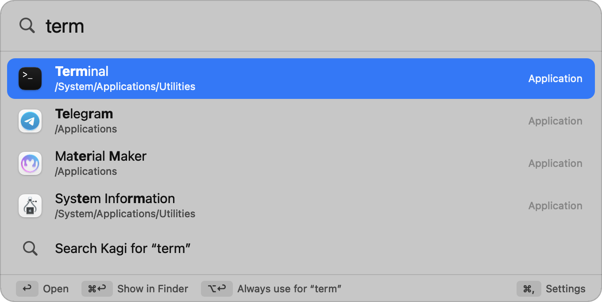
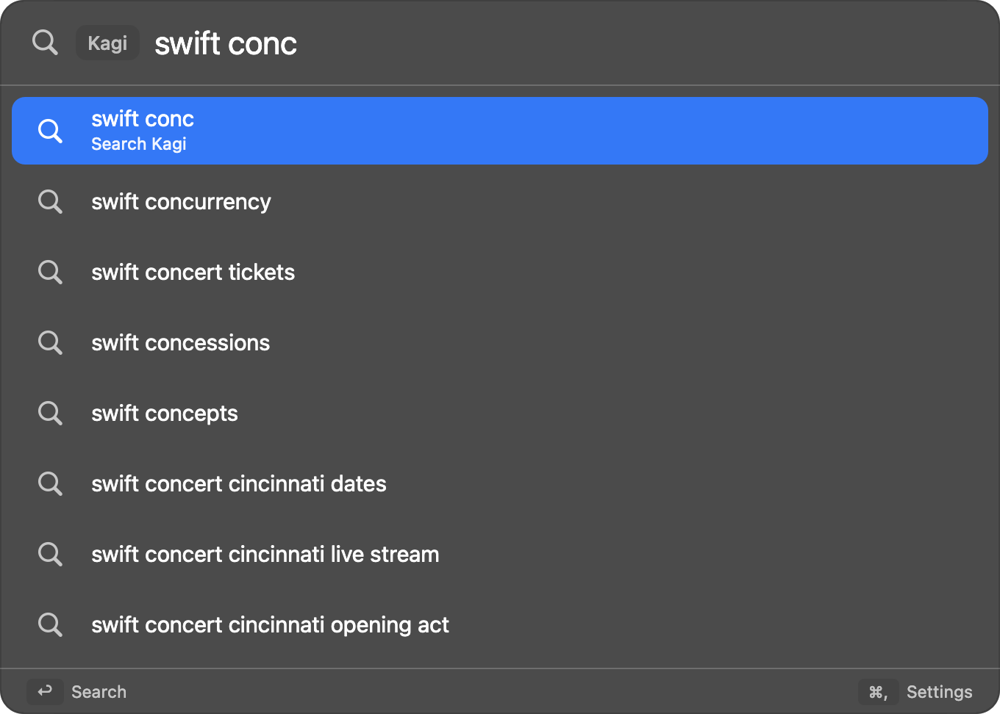
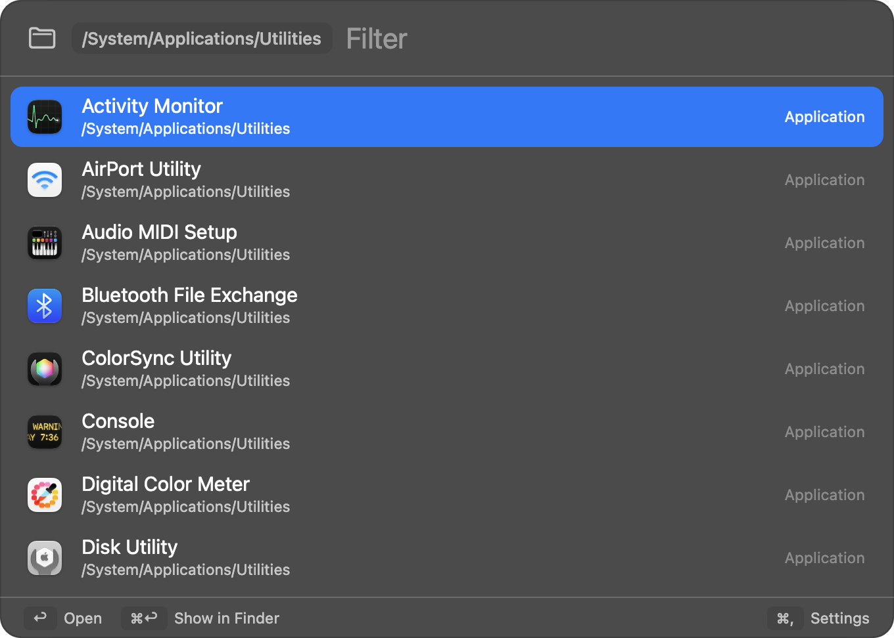
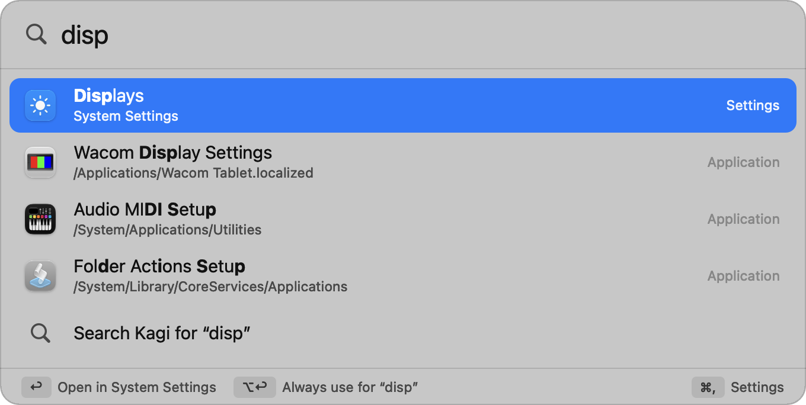
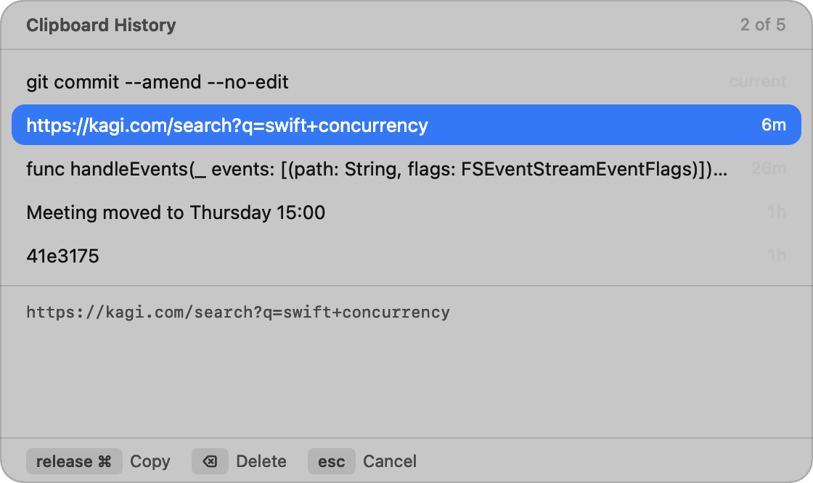

# Quickbar

A small, fast launcher for macOS, built to replace the handful of LaunchBar
features I actually use. Native Swift, no dependencies.



| | |
|---|---|
|  |  |
| Web search with live suggestions | Walking folders with the arrow keys |
|  |  |
| System Settings panes | Clipboard history on ⌘\ |

The images are rendered by the app's headless harness (see Development), so
they lack the blur and shadow of the real window.

## Install

```bash
scripts/install.sh
```

Builds, copies to `/Applications/Quickbar.app` and starts it. Turn on
**Launch at login** in Settings.

## Using it

| Key | What it does |
|-----|--------------|
| ⌥Space | Show / hide the bar (change in Settings) |
| type | Abbreviation search over apps, files, folders, System Settings panes, search templates |
| ↑ ↓ | Move through results |
| ↩ | Open the selected item |
| ⌘↩ | Reveal it in Finder |
| ⌥↩ | Open it and pin what you typed as its abbreviation |
| → | Step into the selected folder |
| ← | Go to the containing folder |
| ⇥ | On a search template or folder: step in. Otherwise: search the web for what you typed |
| Space | After an abbreviation that selected a search template: start typing the query |
| ⌫ on empty text | Back to the index |
| ⌘, | Settings |
| ⌘Q | Quit Quickbar (while the bar or clipboard panel is open) |
| Esc | Hide |

- **Retype delay.** Pause for a second and the abbreviation is selected, so
  the next key starts a new one. Text that is not an abbreviation (math, URLs,
  paths, several words) is left alone.
- **Learning.** Pick the same item for an abbreviation three times and it
  becomes the first result. Custom abbreviations (Settings, or ⌥↩) always win.
- **Math.** `2+2`, `sqrt(2)*10`, `15% * 80`, `2^10`, `0xff + 1`. ↩ copies the result.
- **URLs.** Type or paste one; ↩ opens it.
- **Paths.** Start with `/` or `~` to walk the file system from anywhere.
- **Kagi.** `kagi`, Space, then type: suggestions appear as you type. Anything
  with no better match also offers "Search Kagi for …". Suggestions are only
  requested while you are typing a search, never for ordinary abbreviations.

### Clipboard history

Everything you copy as text is kept (100 entries by default). Hold ⌘ and press
`\` repeatedly to step back through older entries; release ⌘ and the selected
one is on the clipboard. ⌘⇧\ steps the other way. If you tap and release
quickly the list stays open: ↑ ↓ to choose, ↩ to take, ⌫ to delete an entry,
Esc to cancel. Entries marked as secrets by password managers are skipped.

## Configuration

Settings covers hotkeys, the retype delay, indexed folders and their depth,
abbreviations and search templates. Everything is stored in
`~/Library/Application Support/Quickbar/config.json`, which can also be edited
by hand; run "Reload Quickbar Config" from the bar afterwards.

## Development

See [CLAUDE.md](CLAUDE.md) and [PLAN.md](PLAN.md).
